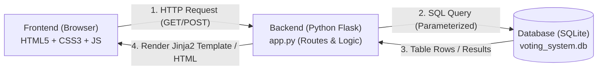
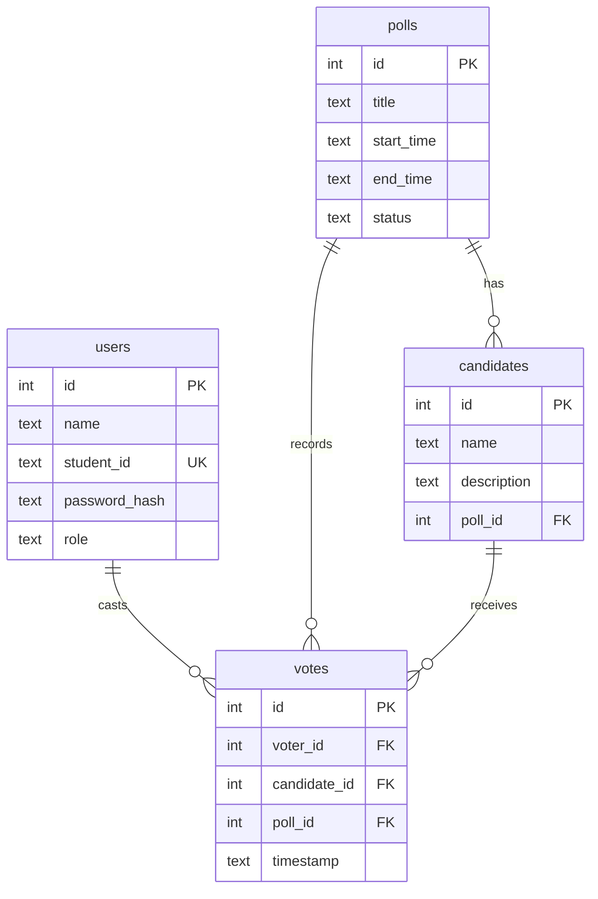

# Online Voting System

A clean, beginner-friendly full-stack mini project built with **HTML/CSS/JavaScript**, **Python Flask**, and **SQLite**.

> [!WARNING]
> **Educational Demonstration Disclaimer**
> This project is designed exclusively for classroom and educational demonstration purposes. It does **not** provide the advanced cryptographic anonymity, verifiable paper audit trails, coercion resistance, or tamper-proof auditing required for official or legal public elections.

---

## 📁 Project Folder Structure

```text
voting system/
│
├── app.py                  # Main Flask application with routes, sessions, & logic
├── database.py             # SQLite helper functions, connection handling, & seeds
├── schema.sql              # Database DDL (tables: users, polls, candidates, votes)
├── init_db.py              # Script to reset/initialize database & populate demo data
├── test_app.py             # Automated unit & integration tests
├── requirements.txt        # Python package dependencies (Flask, Werkzeug)
├── README.md               # Documentation and setup guide
│
├── static/                 # Static assets served to the browser
│   ├── css/
│   │   └── style.css       # Responsive, modern CSS with custom variables
│   └── js/
│       └── main.js         # Client-side scripts (ballot confirmation, alerts)
│
└── templates/              # Jinja2 HTML templates
    ├── base.html           # Master layout with navbar, alerts, & disclaimer footer
    ├── login.html          # Voter & Admin sign in with 1-click demo fill buttons
    ├── register.html       # Student voter registration form
    ├── vote.html           # Elections list & candidate ballot casting interface
    ├── results.html        # Real-time election results with progress bars
    └── admin.html          # Administrator dashboard for polls & candidate management
```

---

## 🔗 How Frontend, Backend, and Database Connect

The project follows the standard **Model-View-Controller (MVC)** web pattern:



1. **Frontend (Browser - HTML/CSS/JavaScript)**:
   - The user opens the site in their browser.
   - Interactive forms send `GET` and `POST` requests to the Flask server.
   - JavaScript in `static/js/main.js` provides instant UX enhancements like confirming the ballot submission before sending it, hamburger menu toggling on mobile, and 1-click credential auto-fill for testing.

2. **Backend (Python Flask - `app.py`)**:
   - Routes incoming HTTP requests to corresponding Python functions (e.g. `/register`, `/login`, `/vote/<id>`, `/results/<id>`, `/admin`).
   - Uses **Flask Session** cookies (encrypted with `app.secret_key`) to remember who is logged in and what role they hold (`voter` or `admin`).
   - Validates input, hashes passwords with `generate_password_hash()`, and enforces business rules (such as checking if a user has already voted).

3. **Database (SQLite - `voting_system.db`)**:
   - Stores all application state in 4 relational tables.
   - Connected via Python's built-in `sqlite3` module.
   - Uses parameterized SQL queries (`?`) to prevent SQL Injection attacks.
   - Uses `UNIQUE(voter_id, poll_id)` constraint in the `votes` table to guarantee at the database level that no voter can double-vote.

---

## 🗄️ Database Tables Schema



- **`users`**: Contains voter and admin accounts. Stores `student_id` (unique) and a salted cryptographic hash of their password.
- **`polls`**: Stores elections (e.g., "Student Council President Election 2026"), operating windows, and `status` (`active` or `closed`).
- **`candidates`**: Stores candidate names, manifesto descriptions, and their associated `poll_id`.
- **`votes`**: Records each ballot with `voter_id`, `candidate_id`, `poll_id`, and a `timestamp`. Has a `UNIQUE (voter_id, poll_id)` constraint.

---

## 👥 Sample Demonstration Accounts

The database comes pre-seeded with these ready-to-use accounts:

| Role | Name | Student ID | Password | Status / Purpose |
| :--- | :--- | :--- | :--- | :--- |
| **Admin** | System Administrator | `ADMIN001` | `admin123` | Can add/delete candidates, toggle polls, and view voters roster |
| **Voter 1** | Alice Johnson | `STU1001` | `voter123` | Pre-voted in Poll 1 (to demonstrate live vote tallies immediately) |
| **Voter 2** | Bob Smith | `STU1002` | `voter123` | Ready to vote! Use this to test the voting ballot workflow |

*(Tip: On the Sign In page, you can click any of the "Quick Demo Accounts" pill buttons to auto-fill the login form instantly!)*

---

## 🚀 Setup & Run Instructions

### 1. Requirements
- Python 3.7 or higher installed on your computer.

### 2. Install Dependencies
Open your command prompt or terminal in this folder and install Flask:

```bash
pip install -r requirements.txt
```
*Or directly:*
```bash
pip install "flask<2.3" "werkzeug<3"
```

### 3. Initialize / Reset the Database
Run `init_db.py` to create the SQLite tables and load the sample accounts:

```bash
python init_db.py
```
You will see:
```text
[OK] Sample demonstration accounts and polls loaded.
[OK] Database successfully initialized at: .../voting_system.db
```

### 4. Run the Flask Web App
Start the local server:

```bash
python app.py
```
You will see output similar to:
```text
============================================================
 ONLINE VOTING SYSTEM (Classroom Demonstration Project)
 Access the application at: http://127.0.0.1:5000
 Default Admin: ADMIN001 / admin123
 Default Voter: STU1001 / voter123
============================================================
 * Running on http://127.0.0.1:5000/ (Press CTRL+C to quit)
```

### 5. Open in Your Browser
Open your browser and navigate to:
```text
http://127.0.0.1:5000
```

---

## 🧪 Step-by-Step Testing Guide

### Scenario 1: Cast a Vote as a Registered Voter (Student Portal)
1. Go to `http://127.0.0.1:5000/login` (or `/student`).
2. Click the student demo button **STU1002** or type `STU1002` with password `voter123`.
3. Click **Sign In to Vote**.
4. You will land on the **Student Voting Portal**. Click **"Cast Your Vote"** on *Student Council President Election 2026*.
5. Select a candidate (e.g., *Maya Chen*) and click **Confirm & Cast Ballot**.
6. A confirmation dialog appears to ensure you wish to vote for that candidate. Click **OK**.
7. You are redirected to the **Live Results** page with a green success message and updated vote count and percentage bars!

### Scenario 2: Test the "One Vote Per Voter" Protection
1. While still logged in as `STU1002`, try navigating to `http://127.0.0.1:5000/vote/1`.
2. Notice that the candidate options are disabled and an alert states: *"Ballot Cast! You have already submitted your vote in this election."*
3. If a user attempts to bypass this by posting manually, the backend intercepts it and displays a warning: *"You have ALREADY voted in this poll. Each voter is allowed only one vote."*

### Scenario 3: Register a Brand New Voter
1. Click **Sign Out** in the top navbar.
2. Click **Register** or go to `http://127.0.0.1:5000/register`.
3. Enter your name (e.g. `Emma Watson`), Student ID (e.g. `STU2040`), and password `password123`.
4. Submit the form. You are redirected to login with a success notice.
5. Sign in with `STU2040` / `password123` and cast your vote in any active election!

### Scenario 4: Admin Management Portal (Dedicated Admin Page)
1. Go to `http://127.0.0.1:5000/admin/login` or click **Admin Portal** in the navigation bar.
2. Click the admin demo button `ADMIN001` or sign in with `ADMIN001` / `admin123`.
3. You will land on the **Administrator Management Portal** (`/admin`).
4. In the admin dashboard Quick Actions toolbar:
   - **Button 1 (`+ Add Election Name`)**: Click this button to open the election creation dialog. Enter **only the election name** (e.g. `Computer Science Dept Representative 2026`) and click **Save Election Name**. The election is immediately created and set to active.
   - **Button 2 (`+ Add Candidate Details`)**: Click this button (or click `+ Add Candidate` directly on any election row) to manually add candidate details. Select the election, type candidate full name (e.g., `Lucas Gray`) and candidate details / campaign platform, then click **Save Candidate Details**.
   - **Close/Re-open Poll**: Click **Close Poll** on any election row to immediately halt voting.
   - **View Registered Voters**: Scroll to the bottom table to see every registered student and how many ballots they have cast.
   - **Delete Candidate**: Click the **Delete** button next to any candidate with automatic confirmation.

### Scenario 5: Run Automated Tests
You can verify the entire backend logic in 1 second by running:
```bash
python test_app.py
```
All 11 test cases will run and report `OK`.

---

## 🔒 Security Features Implemented (for Demonstration)

- **Password Hashing**: Passwords are never saved as plaintext; they are hashed using PBKDF2 with SHA-256 via Werkzeug.
- **SQL Injection Prevention**: All SQL queries use parameter placeholders (`?`).
- **Access Control Decorators**: `@login_required` and `@admin_required` prevent unauthorized access to sensitive pages.
- **Enforced One-Vote Policy**: Guarded both in Python application logic and with a SQLite `UNIQUE(voter_id, poll_id)` constraint.

---

## ☁️ Free Cloud Deployment Guide (Render.com)

This repository includes `Procfile`, `render.yaml`, and production Gunicorn configurations ready for **1-click free deployment**.

### Steps to Deploy to Render in 2 Minutes:
1. Go to **[https://render.com](https://render.com)** and sign in with your GitHub account (`sreenivasulus832-debug`).
2. Click **New +** and select **Web Service**.
3. Choose **Build and deploy from a Git repository**.
4. Select your repository: **`sreenivasulus832-debug/project`**.
5. Render will automatically detect the settings:
   - **Name**: `online-voting-system`
   - **Environment**: `Python 3`
   - **Build Command**: `pip install -r requirements.txt && python init_db.py`
   - **Start Command**: `gunicorn app:app`
   - **Plan**: `Free`
6. Click **Deploy Web Service**!
7. Within 1-2 minutes, Render will build and deploy your app, providing a live public URL (e.g., `https://online-voting-system.onrender.com`) that anyone can open on phone, tablet, or PC to vote!
